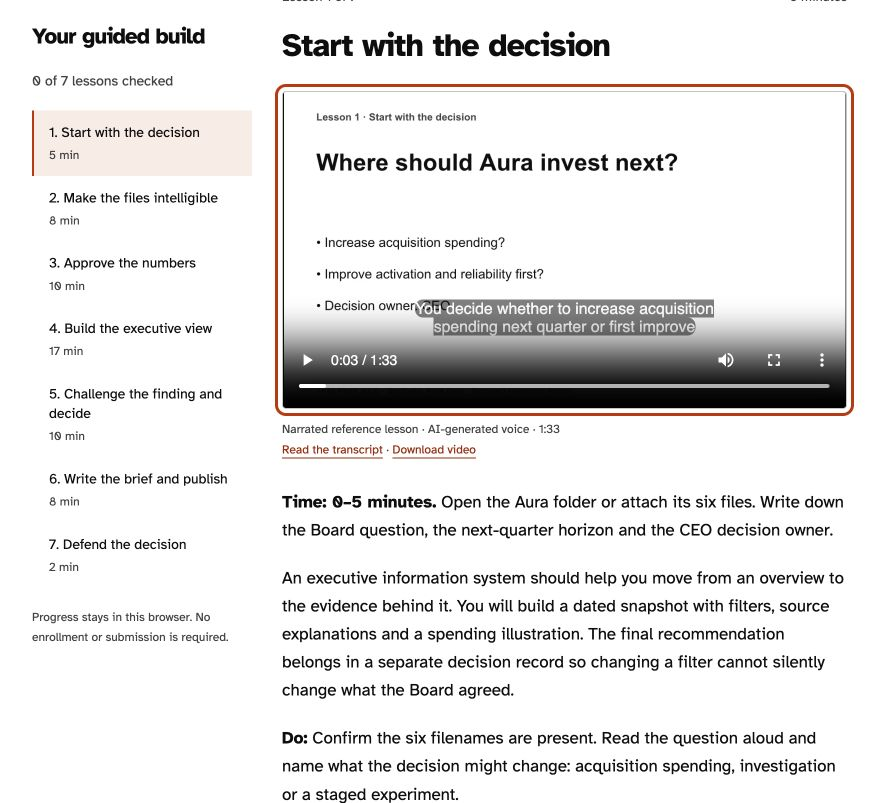

# Marin narration verification

15 November 2026. The owner selected Marin after comparing two OpenAI samples. All seven reference lessons now use AI-generated Marin narration through `gpt-realtime-2.1-mini`.

The 187 completed speech responses match the approved source words. All 187 local PCM hashes, sentence boundaries, rendered-video hashes, H264/AAC encoding, caption text/bounds and transcript coverage passed verification. FFmpeg fully decoded every video without errors. The clips total 914.383 seconds, about 15:14, within the 20-minute explanation budget. The 29 slides and approved scripts are unchanged.

The 21 course/dashboard/speech tests pass, along with two aggregate media-budget regressions. The independent producer review found no blocking code issue; see `marin-code-review.md`. TFIS's local suite passes 337 tests and its build preserves all 53 course assets exactly. The original six-file data ZIP is unchanged. Rebuilding the portable dashboard ZIP changed its container bytes; every file inside it remains byte-identical.

GitHub test-and-build, Cloudflare Pages and GitGuardian all passed for TFIS source `67fddd4712e449d3b7d0105b20d74c9f6f22fde4`. Evidence: `marin-tfis-ci.json`. A separate check with every raw-audio cache path absent verified the delivered videos/captions and all 187 stored receipts; see `marin-portability-verification.json`.

## Published previews

- [Private ChatGPT course preview version 2](https://tfis-pivot-2026-course-preview.khalilnooh.chatgpt.site), source `9b5aebe1d33566b4f08a75d7d01d56206b6142c7`, deployment `appgdep_6af9c3616e70819188ef3233e02e9055`, status succeeded. Access still has one owner and no groups or editors.
- [Cloudflare preview](https://6a29c662.tfis.pages.dev/pivot-2026/), source `67fddd4712e449d3b7d0105b20d74c9f6f22fde4`. Cloudflare's check reports deployment successful. The existing Access policy is unchanged. No new browser check of this Cloudflare route is claimed here.

Hosted ChatGPT lesson 1 played with duration 93.2 seconds, readyState 4, elapsed time 3.91 seconds and English captions showing. It was paused afterwards. The browser reported no console errors or warnings. This is representative playback evidence, not a complete listening review.

## Remaining human checks

Listen to each complete video for pronunciation, cadence, clipping and perceptual caption timing. The selected voice sample and returned transcripts do not establish those qualities across all clips. Use the facilitator media form. The actual-build recording, screen-reader announcements/reading order, text zoom and five executive pilots remain open.

Keyboard checks in the local browser resolved native rubric selection using Alt+Down, End and Enter. The skip link bypassed header navigation and reached the first course action on the next Tab. Synthetic 10/10 and incomplete-dimension checks tested the interface only; they are not learner scores.

## Producer handling

The API key is loaded directly from the ignored local `.env`; it is absent from course assets and manifests. Locked publisher dependencies are installed separately from learner inputs. Raw audio and temporary archives stay in the ignored production cache. Stored response receipts make the published-artifact checks portable without requiring that private cache.

Structured results and recorded successful-response token usage are in `marin-narration-review.json`. Usage records are not a billing invoice. Learners need no API key or additional service purchase.
